# EnergyHub

Control y estimación del consumo eléctrico del hogar para Home Assistant.

**Repositorio:** [github.com/merchedev/EnergyHub](https://github.com/merchedev/EnergyHub)

EnergyHub es una app de Home Assistant (antiguo add-on) con panel propio. Estima la factura, el consumo de cada aparato y el coste por tramo horario, incluso sin sensores de medición. Está pensada para España (2.0TD, Pepe Energy, PVPC/ESIOS) y preparada para añadir más países y tarifas.

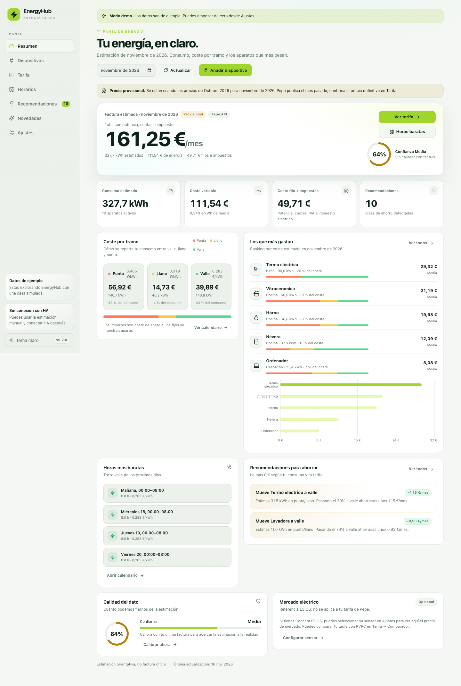

## Qué incluye esta primera versión

- Selector de compañía y tarifa: Pepe Variable, Pepe Estable, PVPC y catálogo comunitario/manual.
- Contrato configurable: potencia P1/P2, cuotas, financiación del bono social, IVA e impuesto eléctrico.
- Autorelleno de precios, cuotas e impuestos desde el perfil de tarifa.
- Pepe Energy con precios automáticos desde su API pública y confirmación.
- PVPC 2.0TD con precios horarios de la API pública de REE, sin token.
- Toggle de cliente Pepephone: cuota de servicio de Pepe a 0 €/mes.
- Descuento del bono social para PVPC, con categorías y límite anual de energía.
- Precios mensuales por tramo o precios horarios, calendario y festivos.
- Dispositivos sin sensores: siempre enchufado, horas al día, ciclos o entidad de HA.
- Cálculo de energía y coste por tramo/hora, con rango mínimo/máximo y confianza.
- Factura estimada, proyección y calibración con la factura real.
- Comparador Pepe vs PVPC con el mismo consumo y potencia.
- Recomendaciones con ahorro estimado y YAML de automatización.
- Creación de automatizaciones en HA con confirmación y opción de deshacer (si HA está conectado).
- Sensor ESIOS opcional como referencia de mercado.
- Página **Novedades**: muestra solo las versiones posteriores a la instalada, no todo el historial.
- Datos locales en SQLite, dentro de `/data`.

## Instalación en Home Assistant OS / Supervised

1. Copia este repositorio a un repositorio Git accesible desde tu Home Assistant.
2. En Home Assistant, ve a **Ajustes → Apps → Tienda de apps**.
3. En el menú superior, abre **Repositorios** y añade la URL de este repositorio.
4. Instala **EnergyHub** y pulsa **Iniciar**.
5. Abre **EnergyHub** desde la barra lateral.

La app usa Ingress: no abre puertos en tu red y el token del Supervisor se queda en el backend.

### Instalación manual de la app

También puedes copiar la carpeta `energyhub/` a `/addons/energyhub/` en tu instalación de Home Assistant y recargar la tienda de apps. La app compila el frontend y el backend en la propia instalación.

## Desarrollo local

Requisitos: Python 3.12+ y Node.js 22+.

```bash
# Backend
python3 -m venv .venv
.venv/bin/pip install -r energyhub/backend/requirements-dev.txt
cd energyhub/backend
ENERGYHUB_DATA_DIR=../../.tmpdata ENERGYHUB_DEMO=1 ENERGYHUB_DEV=1 \
  ../../.venv/bin/uvicorn app.main:app --reload --port 8000

# Frontend, en otra terminal
cd energyhub/frontend
npm install
npm run dev
```

Abre `http://127.0.0.1:5173`. La app carga una casa de ejemplo si usas `ENERGYHUB_DEMO=1`.

### Tests

```bash
cd energyhub/backend
../../.venv/bin/pytest
cd ../frontend
npm run build
```

## Arquitectura

```text
Home Assistant
├── Core: estados, historial, registros, servicios
└── EnergyHub (Ingress)
    ├── React + Vite + Recharts
    ├── FastAPI + SQLite (/data/energyhub.db)
    ├── Motor de estimación y tarifas
    ├── Proveedor Pepe (API pública + confirmación)
    ├── Referencia ESIOS (sensor de HA)
    └── Recomendaciones y automatizaciones
```

Más detalle en [`docs/architecture.md`](docs/architecture.md), [`docs/estimation-and-tariffs.md`](docs/estimation-and-tariffs.md), [`docs/tariff-catalog.md`](docs/tariff-catalog.md) y [`CONTRIBUTING.md`](CONTRIBUTING.md).

### Capturas

| Resumen | Dispositivos |
|---|---|
|  | 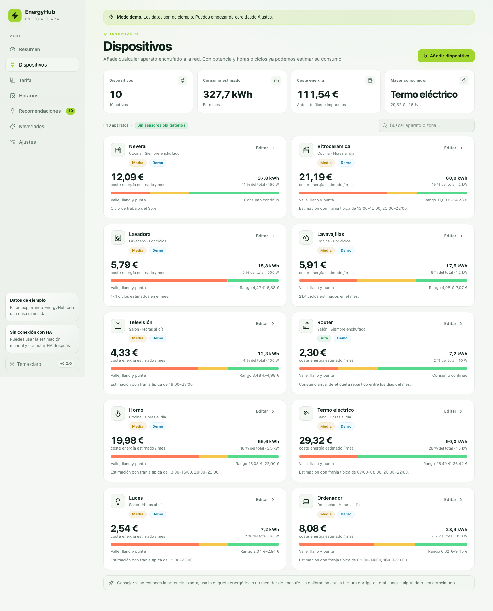 |

| Onboarding | Tarifa y perfiles |
|---|---|
| 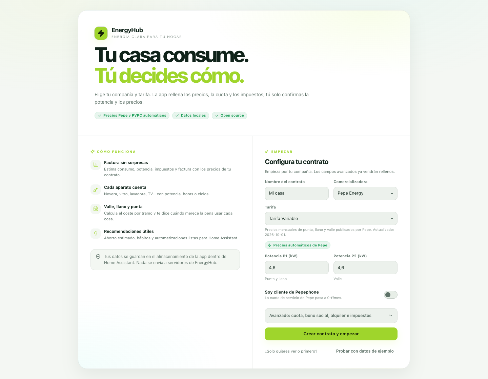 | 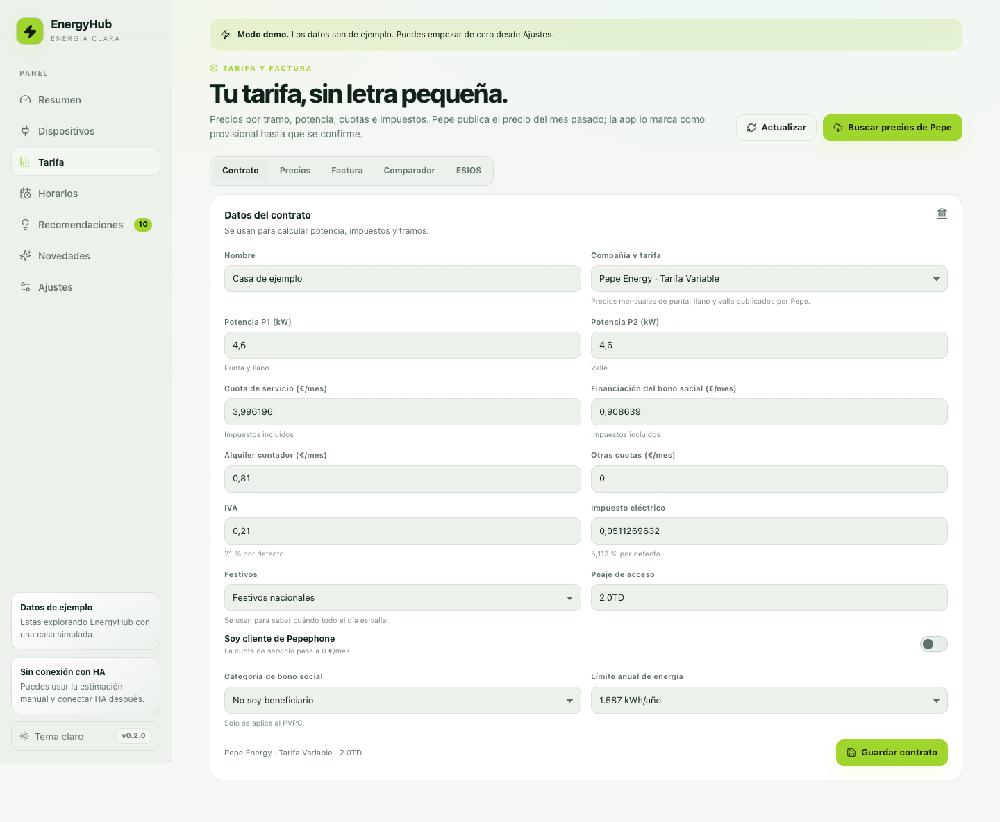 |

| Comparador Pepe vs PVPC | Factura |
|---|---|
| 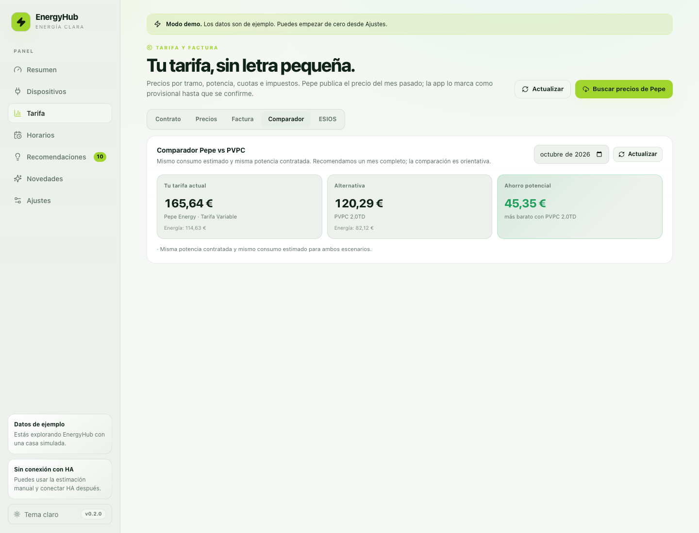 | 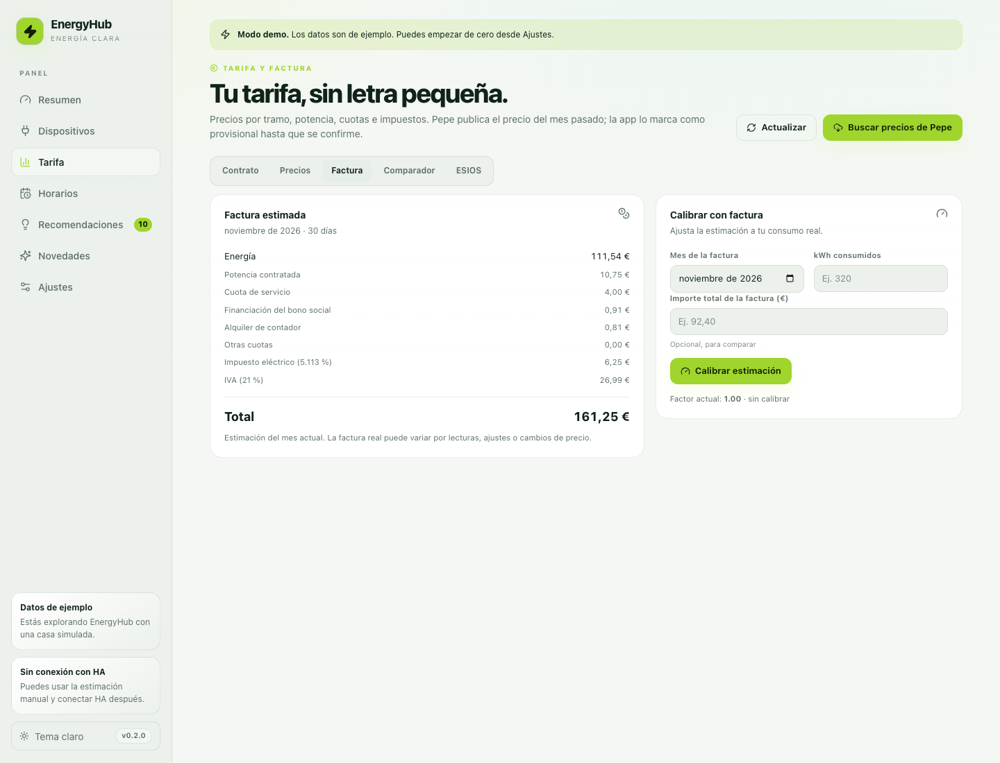 |

| Horarios por tramos | Resumen PVPC |
|---|---|
| 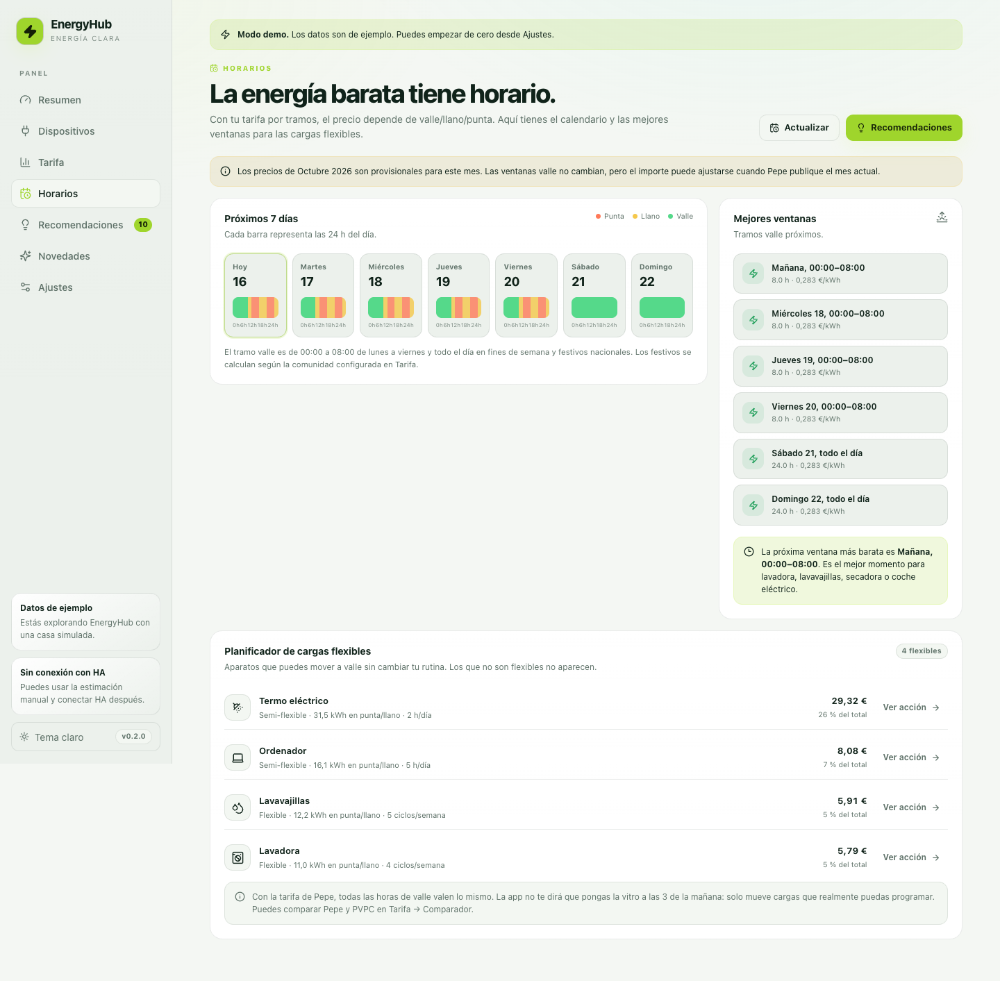 | 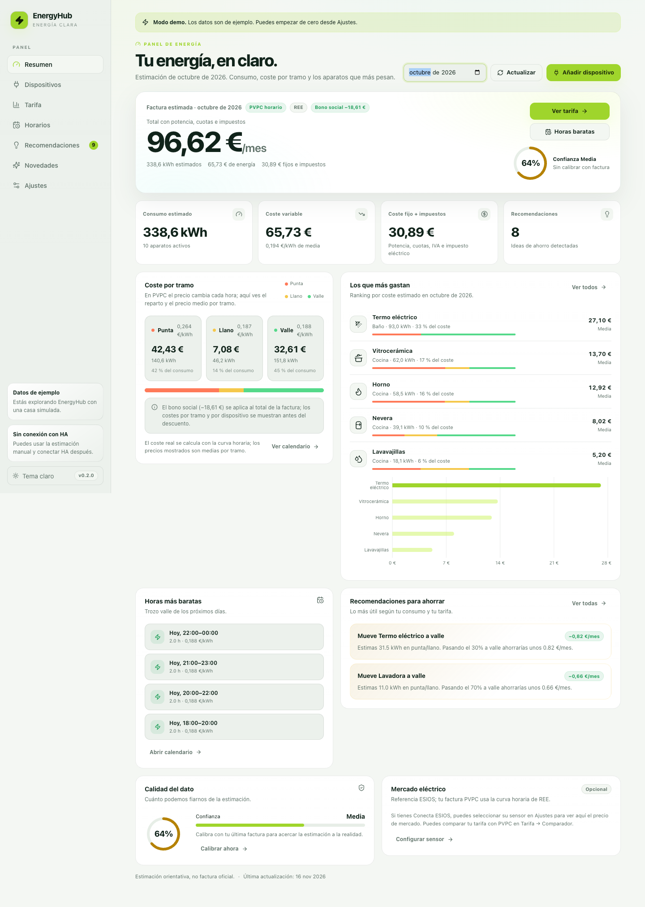 |

| PVPC horario | Recomendaciones |
|---|---|
| 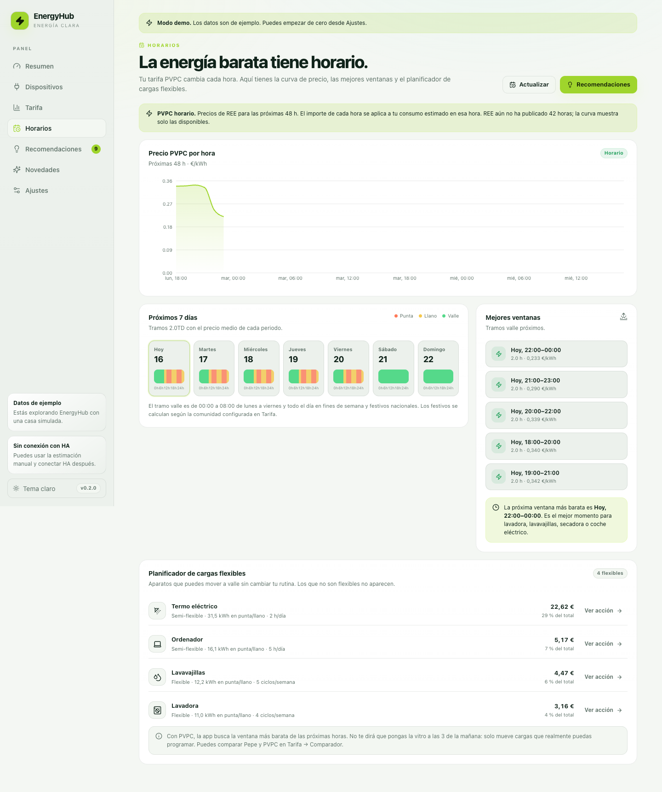 | 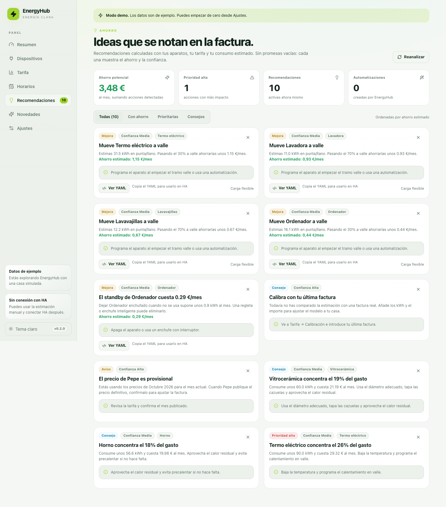 |

| Ajustes | Novedades |
|---|---|
| 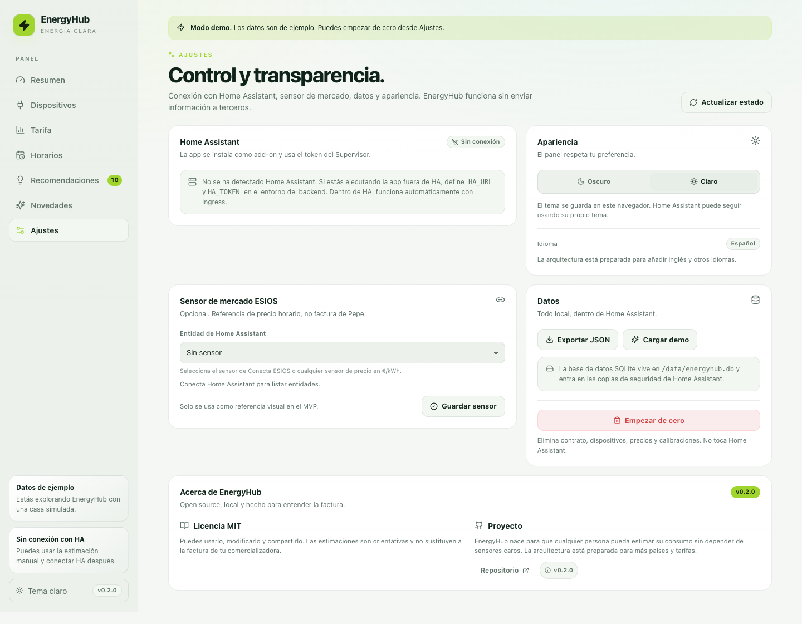 | 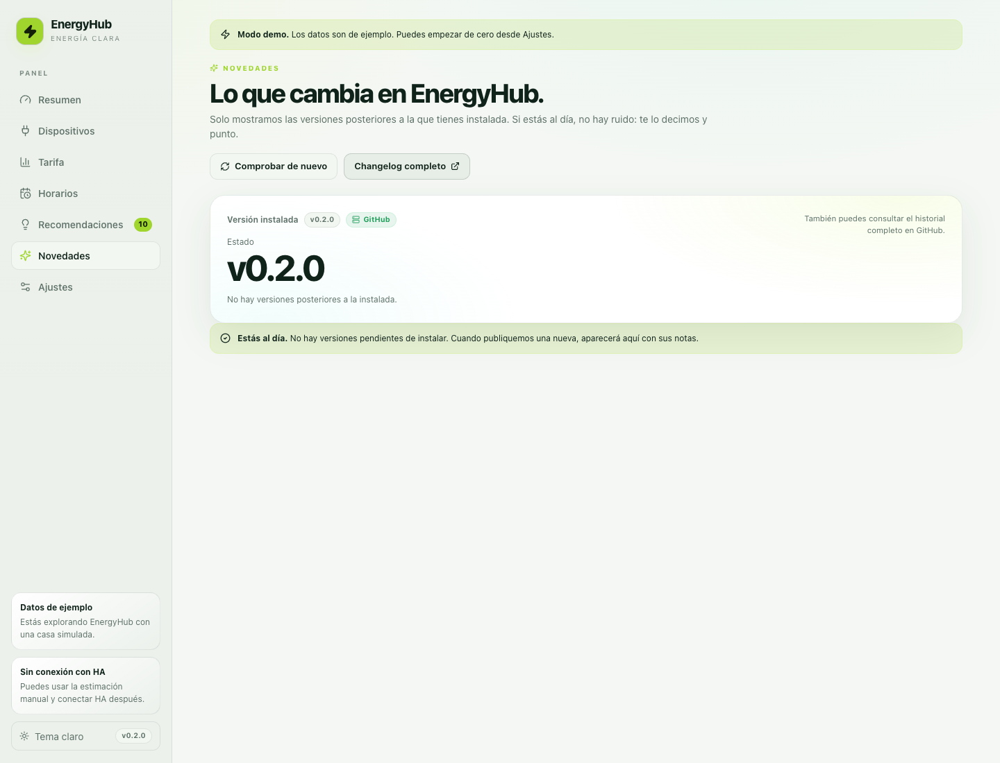 |

## Estado del proyecto

Alpha inicial. El flujo completo de demo, onboarding, tarifa, estimación, factura, PVPC, bono social, comparador y recomendaciones está probado con la API real de Pepe, la API pública de REE y una base de datos local. La conexión con Home Assistant y la creación de automatizaciones están implementadas y preparadas, pero requieren validarse contra tu instalación concreta. Los sensores nativos, el historial real de entidades y el soporte multi-país llegarán en siguientes fases.

El Dockerfile y la estructura de app están incluidos. La imagen se compila correctamente en CI (GitHub Actions); la instalación real en HA OS queda por validar en tu instalación.

## Licencia

MIT. Consulta [`LICENSE`](LICENSE).

Las estimaciones son orientativas y no sustituyen a la factura de tu comercializadora.
